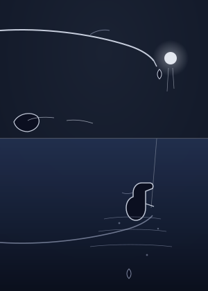
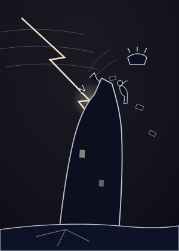
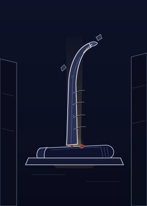
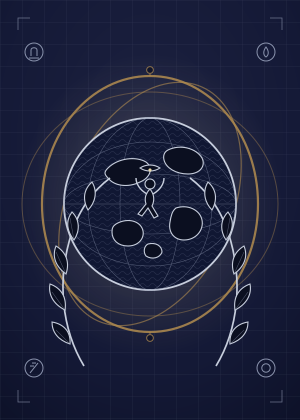

<div align="center">

# 宵月秘藏 · The Veiled Moon Reliquary

**一册可以玩的魔女秘仪档案。**  
在观星台收集星屑，举行启封仪式，将 78 张原创塔罗收藏进属于你的「魔女阁」。

**78 张完整卡组 · 原创程序化 SVG · Local-first · React + TypeScript + Vite**

</div>

<p align="center">
  
  
  
  
  
  
  
</p>

---

## 项目简介

《宵月秘藏》是一款以 **塔罗收藏 + 轻量小游戏 + 秘仪档案叙事** 为核心的 Web 小游戏。

核心循环很简单：

**观星台捕星 → 获得星屑 → 启封一张牌 → 新牌入阁 / 重复补偿 → 推进 78 张收藏**

项目不要求注册账号，核心玩法不依赖任何 API Key；存档保存在浏览器本地。当前版本已经完成主要功能、78 张正式卡面与桌面/移动端适配，进入维护冻结状态。

## 特色

- **完整 78 张卡组**：22 张「月章」+ 56 张「星签」，全部拥有正式 SVG 卡面。
- **原创异形卡牌体系**：月章采用「月芒尖碑」轮廓，四花色星签分别采用独立外形语言。
- **启封仪式**：消耗星屑，在 12 枚封缄中亲手选择并揭示卡牌。
- **魔女阁收藏系统**：完整图鉴、已启封 / 封缄状态、花色筛选、重复次数与详情页。
- **魔女手记**：卡牌详情包含神谕、象征与档案式批注。
- **魔女会旧观星书房**：深靛夜空、旧银、黄铜、羊皮纸、书架与烛光共同构成实体空间，而不是通用黑色网页背景。
- **Local-first**：核心玩法、抽牌、收藏、存档、导入导出均可在本地完成。
- **响应式与无障碍**：Desktop / Mobile 均完成 QA，并支持 `prefers-reduced-motion`。

## 78 张牌

### 月章 · Major Arcana（22）

沿用传统大阿卡纳的名称与顺序，从 **愚者 0** 到 **世界 XXI**。

每张月章拥有独立的构图、叙事母题、主光与完整正式卡面，同时保持统一的旧银秘仪设计语言。

### 星签 · Minor Arcana（56）

四花色各 14 张：

| 花色 | 视觉语言 | 牌序 |
| --- | --- | --- |
| 权杖 · Wands | 木、火、余烬、行动 | A, 2–10, 侍从, 骑士, 王后, 国王 |
| 圣杯 · Cups | 水、器皿、潮汐、反射 | A, 2–10, 侍从, 骑士, 王后, 国王 |
| 宝剑 · Swords | 风、雨、决断、刃线 | A, 2–10, 侍从, 骑士, 王后, 国王 |
| 星币 · Pentacles | 土地、植物、工艺、积累 | A, 2–10, 侍从, 骑士, 王后, 国王 |

数字牌以星座式 pip 与环境叙事建立差异；16 张宫廷牌使用不同镜头、姿态与空间关系表达等级，而不是简单换花色的人物模板。

## 游戏流程

1. **观星台**：在限时小游戏中捕捉星星，获得星屑。
2. **启封仪式**：消耗 30 星屑，从封缄扇阵中选择一枚。
3. **卡牌揭示**：抽牌结果由独立游戏逻辑预先决定，动画只负责表现。
4. **魔女阁**：新牌进入收藏；重复牌转化为补偿星屑。
5. **详情与手记**：查看卡牌的神谕、象征、档案信息与获得记录。

## 快速开始

环境要求：**Node.js ≥ 20**。

```bash
pnpm install
pnpm dev
```

开发服务器默认运行在：

```text
http://localhost:5173
```

常用命令：

```bash
pnpm dev        # 开发模式
pnpm test       # 单元测试
pnpm typecheck  # TypeScript 类型检查
pnpm build      # 类型检查 + 生产构建
pnpm preview    # 预览生产构建
```

仓库包含 `pnpm-lock.yaml`，推荐使用 pnpm。

## 技术栈

| 层 | 技术 |
| --- | --- |
| UI | React 18 |
| Language | TypeScript 5.7 (strict) |
| Build | Vite 6 |
| Routing | React Router 7 |
| State | Zustand 5 |
| Test | Vitest + jsdom |
| Art | Hand-authored / procedural SVG |
| Persistence | browser `localStorage` |

没有引入大型 UI 框架；78 张正式卡面以独立 SVG 资源发射。

## 项目结构

```text
src/
├─ app/                 # 应用入口与路由
├─ pages/               # 主厅 / 观星台 / 启封 / 魔女阁 / 详情 / 星语 / 设置
├─ game/                # 抽牌、经济、收藏、存档、小游戏等纯逻辑
├─ tarot/               # 78 张牌的数据与类型
├─ assets/cards/        # 78 张正式 SVG 卡面
├─ ui/                  # 卡牌、封缄与通用 UI
├─ services/            # 可选能力与本地/AI 解读接口
└─ styles/              # 全局设计系统与环境视觉

docs/                   # 架构、视觉规范、审计与冻结记录
.tools/                 # QA / 截图复现工具
mingrate/               # 历史实验与迁移归档，不参与主前端构建
```

## 存档

存档默认位于浏览器 `localStorage`：

```text
veiled-moon.save.v1
```

记录内容包括星屑、图鉴、获得次数、保底计数、观星统计与设置。设置页支持导出 / 导入 JSON 存档与重置。

## 星语 · 可选解读

「星语」拥有本地牌义解读，因此不配置任何外部服务也可以使用。

如果需要个性化 AI 解读，可以由使用者自行配置兼容接口的 API Key；这不是核心游戏循环的依赖。示例环境变量见 [`.env.example`](.env.example)。

## 当前状态

**Feature-complete / Maintenance mode**

当前基线已经完成：

- 78 / 78 正式卡面
- 22 / 22 月章
- 56 / 56 星签
- 16 / 16 宫廷牌
- 27 / 27 单元测试通过
- Desktop + Mobile 最终 QA
- 核心观星、启封、收藏、详情与存档流程完成
- 正式美术与产品开发均已冻结

后续默认只接受真实 Bug 修复、兼容性维护、展示与文档更新；不继续无边界增加玩法。

## 设计与开发记录

仓库保留完整的设计、审计与冻结记录，便于追溯这套视觉与产品系统是如何形成的：

- [最终美术冻结说明](docs/FINAL_ART_FREEZE.md)
- [78 张正式资产清单](docs/FINAL_ART_ASSET_MANIFEST.md)
- [视觉原创性过程记录](docs/VISUAL_ORIGINALITY_RECORD.md)
- [环境视觉系统](docs/ENVIRONMENT_VISUAL_SYSTEM.md)
- [开发冻结说明](docs/DEVELOPMENT_FREEZE.md)
- [最终产品冻结报告](docs/FINAL_PRODUCT_FREEZE_REPORT.md)

这些文件记录的是研发过程与项目事实，不构成法律意见。

## 关于视觉资产

本仓库中的正式卡面、轮廓系统、装饰语言、环境视觉与项目文案均随项目源码一并公开。卡牌名称与传统塔罗结构沿用通行体系；项目的具体图形表达、界面组合与世界观呈现由本项目独立完成。

如果你只是想快速理解这个项目，可以从 **观星台 → 启封 → 魔女阁 → 卡牌详情** 走完一次完整流程。

---

<div align="center">

**The stars have already spoken. The rest is waiting to be unsealed.**

</div>
